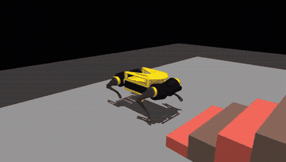
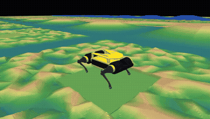
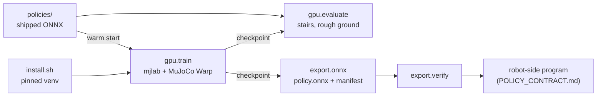
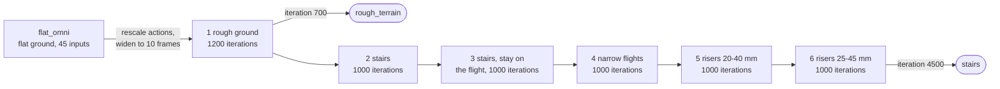

# mp4-sim

Simulation and reinforcement-learning training for the Mini Pupper v4 quadruped (hardware variant SKU2; SKU1 is the
earlier variant, also modelled here). It includes a GPU training recipe for walking on rough ground and climbing
stairs, the trained policies, and export to an ONNX file the robot can run.

> **The SKU2 model is provisional.** It will be regenerated from the corrected SKU2 URDF; see
> [src/mp4_sim/robot/assets/README.md](src/mp4_sim/robot/assets/README.md).

<p align="center">
  
  
</p>

## Requirements

- [uv](https://docs.astral.sh/uv/) 0.12.7 or newer. The installer fetches Python 3.12 if needed.
- Training and evaluation: Linux or Windows with an NVIDIA GPU and driver 580 or newer.
- CPU mode (installs the simulator, the servo models and ONNX tooling without CUDA): Linux, Windows, or macOS 14+ on
  Apple silicon.

## Quick start

```bash
git clone https://github.com/mangdang-bam/mp4-sim.git && cd mp4-sim
bash scripts/install/install.sh                    # GPU or CPU mode, picked automatically (--mode cpu forces CPU);
                                                   # 25-45 min depending on download speed, ~6.5 GB
.venv/bin/python -m pytest tests                   # ~3 min the first time (GPU kernels compile)

# Score the stair policy on a staircase of four 25 mm risers and 50 mm treads (~4 min)
.venv/bin/python -m mp4_sim.gpu.evaluate --policy policies/stairs --terrain stairs_built \
  --risers 0.025 --tread 0.05 --steps 4 --width 0.20 --landing 0.25 --heading-loop --stop-at-goal \
  --tilt-limit 1.0 --foot-solref 0.01 1 --start-noise 0.01 2 --envs 256 --seconds 30 --seed 11 \
  --json runs/eval/stairs.json
# (--start-noise 0.01 2: each trial starts with up to 10 mm of lateral and 2° of heading placement error)

# Train the rough-ground and stair policies from the flat-ground policy (~4 h on an RTX 5080)
sh scripts/recipes/stairs.sh

# Export a checkpoint to ONNX and check it (a run prints its directory as RUN_DIR; checkpoints are model_<iteration>.pt)
.venv/bin/python -m mp4_sim.export.onnx --checkpoint runs/recipes/<step 6 run>/model_4500.pt --out runs/export/my_stairs
.venv/bin/python -m mp4_sim.export.verify runs/export/my_stairs
```

On Windows: `powershell -ExecutionPolicy Bypass -File scripts\install\install.ps1`. Installer options, pins and the
reasons for them are in [docs/INSTALL.md](docs/INSTALL.md).

## How the pieces fit



The stair policy is trained in six steps, each fine-tuning the previous one:



## Policies

Each folder in `policies/` holds `policy.onnx` (with its manifest), `fixture.npz` (reference inputs and outputs for
`export.verify`) and `config.json` (how it was trained). In CPU mode the policies can be checked with
`export.verify`; training and evaluation need the GPU install.

| Policy | Task | Inputs | Command | Success |
|---|---|---|---|---|
| `stairs` | climb stairs | 450 (10 frames × 45) | forward speed, heading held by a PI loop | 94.1 % on four 25 mm risers, 50 mm treads, 200 mm wide (512 trials) |
| `rough_terrain` | walk on rough ground | 450 (10 frames × 45) | forward speed; trained with a P heading loop, runs with the PI loop in its manifest | 84.4 % reach 0.65 m on the `rough` terrain mix at difficulty levels 3, 6 and 9 (of 0-9; 512 trials) |
| `flat_omni` | walk on flat ground | 45 | forward, sideways and turning speed | the recipe's starting point |

The heading loop is a PI controller that turns the heading error into the yaw-rate command, as the robot does. The
input and output layout, the history order and the heading loop a robot-side program must compute are in
[docs/POLICY_CONTRACT.md](docs/POLICY_CONTRACT.md).

## Training

`sh scripts/recipes/stairs.sh [LAST_STEP]` runs the six steps in order and skips finished ones; `LAST_STEP=1` stops
after the rough-ground policy. Runs go to `runs/recipes/` (TensorBoard logs included). Step 1 by hand:

```bash
.venv/bin/python -m mp4_sim.gpu.train --variant warm_start --init policies/flat_omni --heading loop \
  --foot-softness 0.005 0.02 --friction 0.4 1.3 --vx-max 0.12 --clearance apex --clearance-weight -2 \
  --stumble -0.5 --progress 2 --envs 1024 --terrain rough --history 10 --iters 1200 --seed 4 --tag rough \
  --out runs/recipes
```

Steps, options and timings: [docs/TRAINING.md](docs/TRAINING.md).

## Evaluation and export

The figures in the table come from the quick start's stair command and this rough-ground command, each run as shown
(`--seed 11`) and again with `--seed 12` (2 × 256 trials):

```bash
.venv/bin/python -m mp4_sim.gpu.evaluate --policy policies/rough_terrain --terrain rough --levels 3 6 9 \
  --terrain-seed 7 --heading-loop --stop-at-goal --goal 0.65 --envs 256 --seconds 20 --seed 11 \
  --json runs/eval/rough.json
```

- `python -m mp4_sim.gpu.evaluate --policy <dir>` runs a policy on a course and reports success, falls and distance per
  cell; `--terrain stairs_built` builds a staircase from `--risers --tread --steps --width --landing`, `--terrain rough`
  the procedural rough-ground mix; `--json` writes per-trial results, `--video out.mp4` renders one robot (set
  `MUJOCO_GL=egl` on a headless machine).
- `python -m mp4_sim.export.onnx --checkpoint <model.pt> --out <dir>` writes `policy.onnx`, its manifest and a fixture;
  `python -m mp4_sim.export.verify <dir>` checks it with ONNX Runtime.

## What is where

```
src/mp4_sim/
  contract.py       observation / action definition shared with the robot, observation history
  heading.py        the heading loop (PI law) used in training, evaluation and on the robot
  robot/            SKU1 and SKU2 models (MJCF, URDF, meshes, servo maps, masses, contract)
  actuators/        BAM (Better Actuator Models) servo models, vendored, with parameters fitted to the robot's MD01
                    servos; GPU and CPU servo actuators
  gpu/
    train.py        PPO training on MuJoCo Warp, warm start from an ONNX policy
    terrain_task.py rough-ground and stair tasks: terrain, curriculum, rewards, heading loop
    terrain.py      terrain generators (rough relief, slopes, stairs, narrow flights)
    env_cfg.py      base task: observations, actions, servo model, noise
    mdp.py          observation, action and reward terms
    algorithms.py   PPO with an extra loss term that keeps actions close to the warm-start policy (the one training
                    starts from) early in training
    evaluate.py     courses and scoring
    patch_warp.py   removes a per-step warning from mujoco-warp's heightfield collision
  export/           ONNX export, manifest, verification
  cpu/              reserved for CPU environments
policies/           shipped policies (ONNX + manifest)
scripts/
  install/          installers (Linux/macOS, Windows) and the post-install check
  recipes/stairs.sh the six-step training recipe
tools/              model generation from the URDF
cad/                CAD exports the models are built from
docs/               install, training, policy contract, design notes
```

## Licence

Apache-2.0: see [LICENSE](LICENSE) and [NOTICE](NOTICE).
